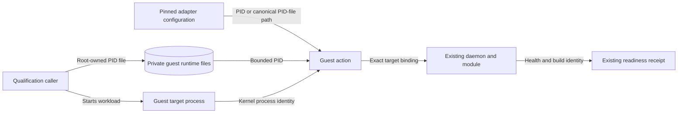

# BigRAE adapter boundary

The independent `owlbear-bigrae-adapter` wheel depends only on the public
`bigrae-adapter-sdk[runtime]` contract and standard library. It registers one
factory in `bigrae.runtime.plugins`. SDK plans authorize one Linux guest;
configuration selects an already staged release under /opt/owlbear/releases.
It never fetches releases, creates infrastructure, or accesses cloud credentials.

Flow: RuntimeInput -> closed configuration -> bounded GuestAction -> existing
artifact verifier, module loader, daemon CLI -> control socket readback.
Verification checks artifact identity and bytes, running kernel/architecture,
loaded module GNU build note, authenticated daemon build and runtime readback. Only guest
execution exit status proves readiness; a planned action does not.

Each operation has its own private /run/owlbear-<operation UUID> directory.
Existing healthy state is read back on retry; incompatible state fails rather
than being killed/replaced. Core owns guest destruction and cleanup. No study,
attack, policy adaptation, or evidence upload belongs here.

Image selection uses SDK PluginManifest validation: exact registry digest,
distribution version and entry point. Image construction consumes a complete
hash-locked wheelhouse, without fetching packages. No fabricated image digest
or publication claim is committed. Tests install built SDK/adapter wheels in a
separate environment and exercise the actual worker; guest predicates have
negative tests and a deliberate mutation check.

## Completed delivery and integration boundary

Consume the already published upstream CI SDK wheel by artifact ID and SHA-256,
including its MIT license; do not rebuild it or require a new PyPI release.
`release.py` creates a hash-locked wheelhouse, worker image, real registry
manifest identity and portable image archive. A disposable loopback registry
exists only for the integration test. CI retains the archive, exact SDK and
adapter wheels, installation declaration, hashes and test receipts through the
repository's existing artifact service. No production registry or tenant is used.

The production worker runs with no network, no capabilities, UID 65532, read-only
root and bounded tmpfs. Guest integration runs on native ARM64 in a separate
container, using the real daemon linked to the existing explicit ioctl/BPF
fixture. Only the guest test has private writable fake sysfs and a fake module
loader. It never mounts host sysfs or loads a real module. Configure, retry,
verify and negative readbacks execute complete SDK-generated guest scripts.
The guest fixture cannot enter the worker image or runtime package.

Live range qualification follows the separate
[qualification boundary](bigrae-qualification.md); integration receipts do not
establish live readiness, attack outcomes or range teardown.

## Newly realized guest targets

Adapter version 0.2.0 retains explicit integer PIDs and accepts a canonical PID-file path under `/run`.
The caller creates the file and starts the workload before the configure action.
The adapter does not start or select a workload.
It requires a root-owned regular file and root-owned ancestors without group or other write permission.
It refuses symlinks, oversized files, malformed numbers, and PIDs below two.
Configure records the target PID and process start time in the private operation directory.
Retry and verify require the same process identity.
The readiness receipt continues to report the realized integer PID.

The file is caller-controlled input across the guest-action boundary.
Exclusive state creation binds retries to the original process and detects PID reuse.
Existing health, release, and loaded-module checks remain mandatory.
Target identity tests cover file safety and changed-process rejection.
The GCP image procedure is in `deploy/gcp/README.md`.
Provider-specific image recipes stay outside the runtime adapter.

## Protected identity readback

The private control socket authenticates its peer with Linux SO_PEERCRED.
The reported PID must match that peer and its UID must match the root caller.
Health includes the daemon's compiled `owlbear.build/v1` identity.
The adapter compares that identity with the verified release manifest.
This replaces external executable-symlink inspection, which active ptrace protection denies.
Target retries compare PID and kernel process start time, which remains readable under protection.
An exec within the same process retains that identity; code-integrity evidence remains a separate claim.

BPF exec records encode parent PID, UID, and a bounded executable path.
The userspace converter maps those fields to the shared process payload.
The production daemon and converter tests link the same `bpf_event_convert.c` implementation.
Text descriptions must not be interpreted as numeric process identity.
