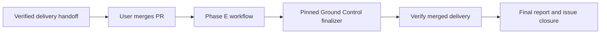

# Ground Control configuration and issue closure

Owlbear uses Ground Control configuration schema 1.
The repository identity is `Brad-Edwards/owlbear`, and delivery PRs target `dev`.
Architecture guidance belongs under `architecture.vocabulary`.
The retired `workflow.design` and `architecture.modules` blocks are not supported.
Keep runtime checks in the existing build and CI jobs when migrating configuration.

## Automatic Phase E

The Phase E workflow runs after a merged PR targets `dev` or `main`.
It also provides a manual repair trigger that accepts a merged PR number.
It checks out the immutable merge revision with checkout credentials disabled.
It installs Ground Control 1.10.0 from its private release archive and verifies the archive's SHA-256.
Package installation scripts are disabled.
The finalizer receives the workflow token as `GH_TOKEN`; its only write permission is `issues: write`.
The download step alone receives the separate read-only release credential.

The workflow calls `grndctl finalize-merged-pr`; it contains no separate issue-closing implementation.
The finalizer reads the trusted delivery handoff recorded by `/implement` or `/quickfix` before merge.
It verifies the handoff's issue, PR, and head identity, then validates merged requirements and closes the delivered issue.
A failure leaves the issue open and records the failure.
A repeated successful run does not create another final report.
A closed, unmerged PR does not run the finalizer.
A PR without a trusted delivery pointer is skipped.



Merge the workflow before relying on automatic handoffs for later delivery PRs.
Adding this workflow does not create handoffs for older PRs.
For an older delivery without a handoff, resume its original `/implement` or `/quickfix` run after merge.
For a failed run with a valid handoff, rerun Phase E or invoke the finalizer from the merged checkout.
The manual GitHub trigger becomes available when the workflow exists on the default branch.
Agents still need a Ground Control connection launched in their working checkout.

## Release access

The Ground Control release repository is private.
Owlbear's workflow token cannot read that repository.
Do not publish the package or copy a developer's broad GitHub credential into Actions.

Before enabling the finalizer, approve use of the private package on Owlbear's GitHub-hosted runner.
Create a GitHub environment named `ground-control` with selected deployment branches `main` and `dev` only.
Set its `GROUND_CONTROL_RELEASE_TOKEN` secret to a fine-grained credential with Contents read access to `autarchy-ai/Ground-Control` only.
Keep the credential value out of chat, repository files, and command arguments.
The download step fails clearly when that secret is absent.
Pull-request CI uses the public YAML parser and receives no private release credential.

## Configuration checks

CI checks the schema 1 configuration shape and the Phase E trigger, merge guard, permissions, checkout, release pin, and finalizer command.
The tests reject a return to schema 2 or either retired block.
They read only the explicit configuration and workflow files; they do not read local environment files.

Run the targeted tests with the package directory of the public `js-yaml` 4.3.2 parser:

```sh
YAML_PACKAGE_ROOT=/path/to/js-yaml node --test tests/test_ground_control.mjs
```

Also validate configuration changes with the installed Ground Control server before publication.

[GitHub release-asset permissions](https://docs.github.com/en/rest/releases/assets#get-a-release-asset)
describe the required read permission.
[Deployment branch policies](https://docs.github.com/en/rest/deployments/branch-policies)
describe the environment restrictions.
